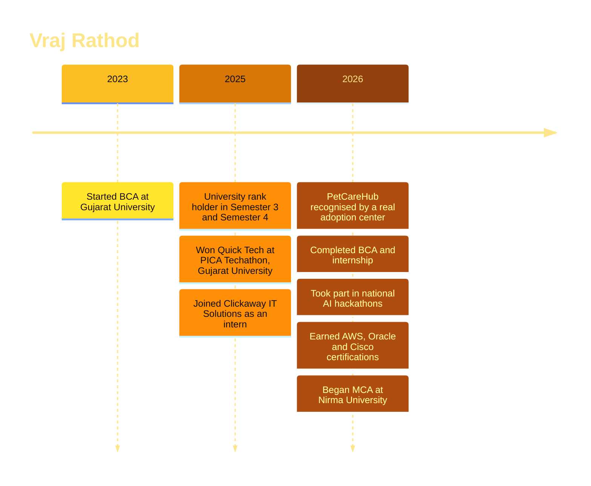
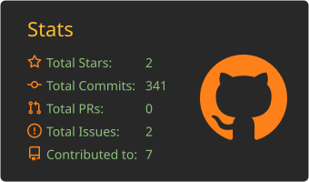
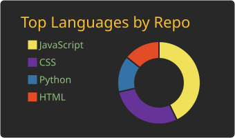
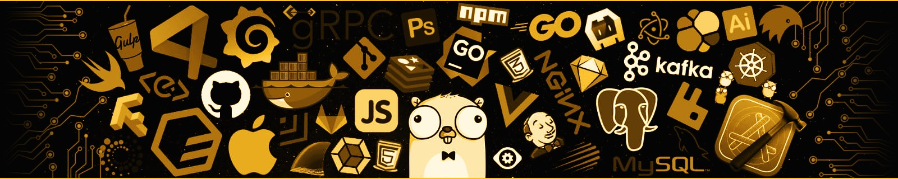

 

 

---

## About Me

I'm a developer from Gujarat, India, with a strong foundation in **Python and Django** and a growing focus on **AI and automation**.

I enjoy turning real-world problems into working products. That means web platforms people actually use, and AI-powered tools that make everyday work a little smarter.

I graduated in BCA from Gujarat University as a rank holder, completed a one-year Python (AI) with Django internship, and I'm now pursuing my **MCA at Nirma University**.

**"Writing robust backend logic on screen, but keeping the rhythm alive away from it—when the IDE closes, I trade the keyboard for the intricate beats of a tabla player, a flutist, a harmonium artist, and a cajon rhythmist."**

| | |
|:--|:--|
| **Role** | Python / Django Developer |
| **Studying** | MCA, Nirma University (2026-28) |
| **Completed** | BCA, Gujarat University (2023 to 2026) |
| **Experience** | Python (AI) with Django Intern, Clickaway IT Solutions |
| **Focus** | AI-powered web apps · Automation · Agentic AI |
| **Credential** | Oracle Certified Foundations Associate, Agentic AI |
| **Languages** | English · Hindi · Gujarati |
| **Location** | Gujarat, India |

---

## My Journey

---

## Experience & Education

| Role | Where | When |
|:--|:--|:--|
| **Python (AI) with Django Intern** | Clickaway IT Solutions, Ahmedabad | Jun 2025 to Jun 2026 |
| **Software Coordinator** (Volunteer) | JCT, Ahmedabad | 2026 |

| Degree | Where | When |
|:--|:--|:--|
| **MCA** (pursuing) | Nirma University | 2026 to 2028 |
| **BCA** | Gujarat University | 2023 to 2026 |

---

## Featured Projects

### PetCareHub

*An all-in-one platform for pet owners: trusted vets, a pet shop with delivery tracking, and adoption.*

Built with a team of two. **Recognised by Adoption Home Ahmedabad** with an official Appreciation Letter and NOC.

[Source code](https://github.com/vraj537/PetCareHub-All-in-one-hub-for-all-your-furry-friends)

### HireProof-AI

*AI-assisted candidate verification for evidence-based hiring.*

Helps recruiters look past polished resumes and make decisions backed by evidence.

[Live demo](https://hireproof-ai-zeta.vercel.app) · [Source code](https://github.com/vraj537/HireProof-AI)

### PitchPanel AI

*Get your startup idea reviewed by an AI panel before you build it.*

Challenges an idea from several viewpoints so founders can spot weak points early.

[Live demo](https://pitchpanel-app.vercel.app) · [Source code](https://github.com/vraj537/pitchpanel-ai)

### More Work

| Project | Overview | Stack |
|:--|:--|:--|
| **InboxGuardian AI** | AI-powered email triage automation | n8n, Gemini |
| **AI Study Companion** | Multi-agent study assistant built solo for a hackathon | Python, Django |
| **MediMart AI Crew** | Multi-agent assistant for a medical store | Python, CrewAI |
| **RidePlex** | Vehicle rental management system | Java, Spring Boot |
| **MERN Task Manager** | Full-stack task manager ([source](https://github.com/vraj537/mern-task-manager)) | MongoDB, Express, React, Node.js |

---

## Achievements

| | |
|:--|:--|
| **Winner** | Quick Tech, PICA Techathon 2025 (President Institute of Computer Application, Gujarat University) |
| **Rank Holder** | Gujarat University Rank 17 (Sem 3) and Rank 22 (Sem 4), BCA |
| **Recognition** | PetCareHub honoured by a real adoption center, Apr 2026 |

### Hackathons

| Event | Organiser |
|:--|:--|
| **Bharatiya Antariksh Hackathon 2026** | Participated in ISRO, powered by Hack2skill |
| **Solution Challenge 2026: Build with AI** | Submitted AI-Powered Prototype (Hack2skill) |
| **iQOO Hackathon 2026**, Pune City Battle | Submitted Ideation and Prototype (Organized by iQOO) |
| **Fund My Crazy: Grand Ideation Night** | CampusCrew, Google Gemini |

### Certifications

| Area | Certification | Issuer |
|:--|:--|:--|
| **AI** | Oracle Certified Foundations Associate, Agentic AI | Oracle |
| | Fundamentals of Machine Learning and AI | AWS |
| | Essentials of Prompt Engineering | AWS |
| **Cloud** | AWS Lambda · Amazon S3 · Amazon EC2 | AWS |
| **Programming** | Python Essentials 1 | Cisco Networking Academy |
| **Database** | SQL (Basic and Intermediate) | HackerRank |

---

## Tech Stack

**Languages**

**Backend**

**Frontend**

**Databases**

**AI & Automation**

**Cloud, Payments & Tools**

---

## How I Work

| | |
|:--|:--|
| **Build for real users** | I care about projects that solve genuine problems, not just demos. |
| **Reliable by design** | I think about edge cases early, so products hold up in real use. |
| **Automate the repetitive** | If a task repeats, I look for a smarter way to do it. |
| **Document everything** | Clear setup and structure so anyone can pick a project up. |

---

## Currently

- Pursuing **MCA** at Nirma University
- Building AI-powered apps and multi-agent workflows
- Going deeper into **Agentic AI** and **Machine Learning**
- Strengthening the **MERN** stack alongside Django

---

## GitHub Activity

<!--

 -->

  

  

  

---

## Dev Quote of the Day

---

---

### Let's build something great together

Open to internships, collaborations and interesting projects.

